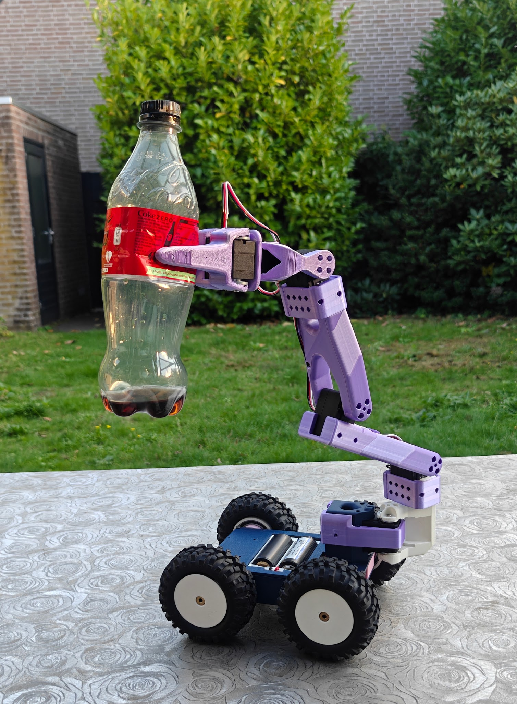
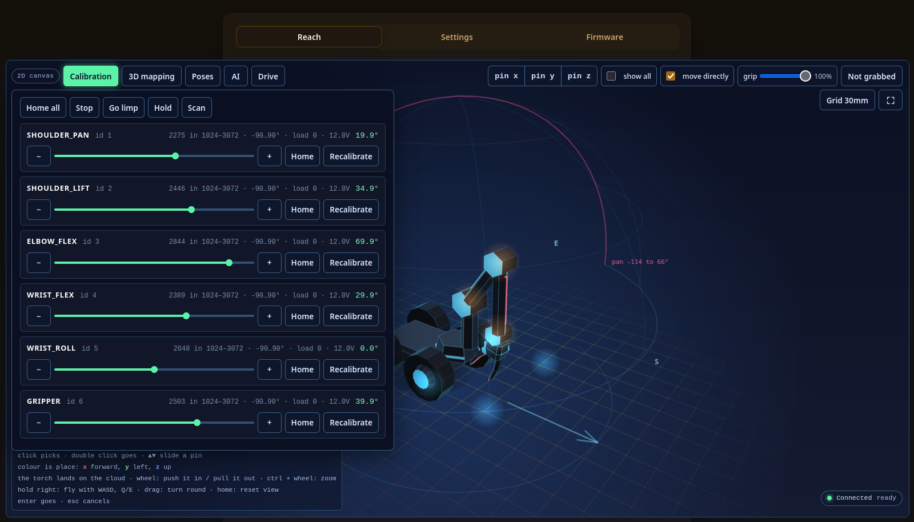
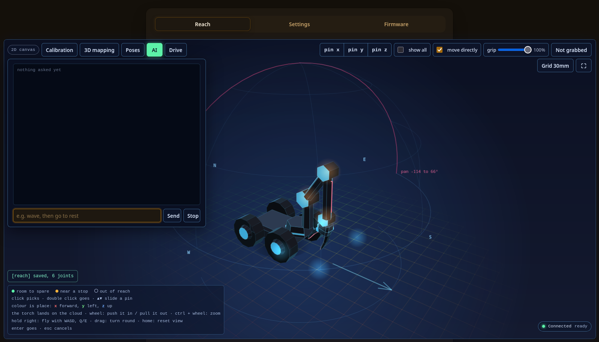
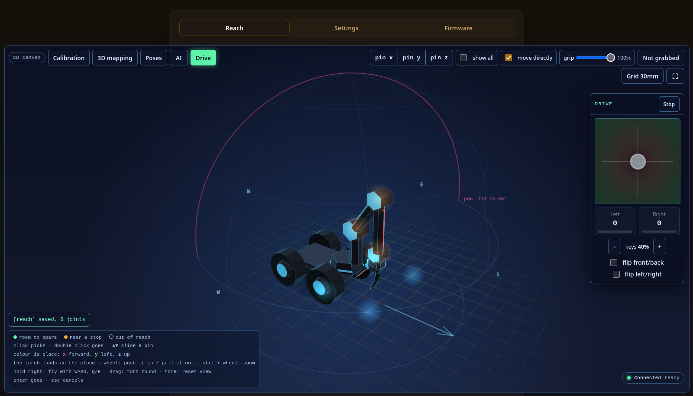
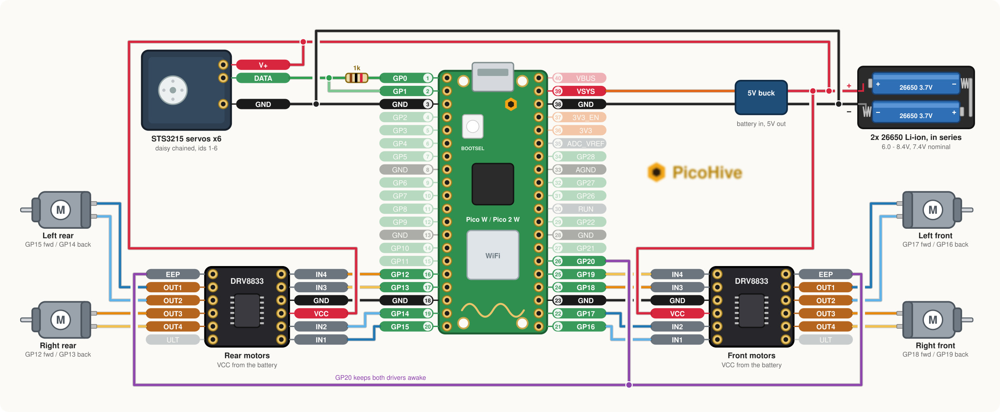

# Pico Robot Arm

Standalone Raspberry Pi Pico W / Pico 2 W controller for an [SO-101 / SO-100](https://github.com/TheRobotStudio/SO-ARM100) arm\
Can control over WiFi via an internal Web Page, MQTT or openAI response API compatible remote\

Video: https://www.youtube.com/shorts/e_Y3U83MK2A




## History

I had an RC car and a LeRobot SO-ARM100 and wanted to see if I can combine them and use an LLM to control...

## How it looks

The arm is drawn in 3D from what the servos report; click a dot to put a target down, **Go** (or Enter) sends the jaws there.

| Calibration | AI | Drive |
|---|---|---|
|  |  |  |

### The Reach tab

- **Calibration**: set up limits for joints so arm doesn't self destruct... (don't ask)
- **3D mapping**: tell robot which way is left or up
- **Poses**: various poses described for openAI LLM knowledge base
- **AI**: chat box with status responses. The microphone needs https
- **Drive**: Virtual joystick to control the wheels, or you can connect a gamepad

## How do I set it up

#### Items to do before

1. **Picohive** *(optional)* - for Debug logs and OTA updates\
  Add Device on [picohive](https://picohive.com) (generate the UUID, MQTT password and log key, pick a name)\
  Open the device, go to **Device Config**, press **Export** and copy the line for step 4 below

2. **OpenAI** *(optional)* - for AI chat box\
  An API key and a model (ex: `gpt-6.1-sol`) on a server that has responses API with storage

#### Device setup

1. **Flash** a pico, it starts as access point `picow_config` / `randompassword` (...ultra secure password...)
2. **Connect** to the access point, the page opens by itself, if not, use http://192.168.4.1
3. **Configure wifi** and a user/pass for the web ui
4. **Optional**:\
4.1. **Remote server** enter line from picohive for logging/OTA/crash reporting\
4.2. **OpenAI** enter the URL, key, model and prompt\
4.3. **MCP** tick *Enable MCP* so Claude Code (or any MCP client) can drive the arm: `claude mcp add --transport http robotarm http://<board>/mcp`, see [os/docs/commands.md](os/docs/commands.md#mcp)
5. **Reboot** - joins your wifi, you can access via its new IP now (find it in picohive logs or on router)
6. **Reconfigure** any time from its new ip address

> [!TIP]
> If you need to wipe, just use the [universal `flash_nuke.uf2`](https://github.com/Gadgetoid/pico-universal-flash-nuke) to wipe the flash then re-flash the firmware

#### Bringing an arm up

This follows LeRobot, in short:
1. Add servos one at a time to pico to set their IDs to not overlap (and baud rate to 115200, 1M was too much for my setup with 1K resistor)

2. Build up the arm and connect things

3. Calibrate from web page (just press the calibrate and move the arm by hand so it learns limits)

4. Go to 3D model and map some positions so it knows left from right and up from down...

## Building firmware

```bash
git clone --recursive https://github.com/AdrianCX/picohive-robotarm.git
cd picohive-robotarm
os/build_via_podman.sh pico2_w      # or pico_w
```

Flash `build/<board>/robotarm.uf2`
Later updates for OTA need the encrypted file `robotarm.uf2.encrypted`
Before you build your own, create your own OTA keys and certificate, as described in [os/docs/ota.md](os/docs/ota.md). The HTTPS certificate is `util/make_cert.sh <address>`.

## Linux simulator

The same app builds on Linux with simulated servos \
Useful to work on web page with valgrind and gdb

```bash
os/build_via_podman.sh linux        # build/linux/robotarm
os/run_via_podman.sh                # http://localhost:8080, https://localhost:8443
os/run_via_podman.sh --valgrind     # or --gdb
```

## Memory usage

```
[2026-10-25 13:52:12] 192.168.100.69 657 app[build/pico_w/robotarm] version[1.0] os[b697060-dirty] buildid[db40f1ac39e2b3ee3d07d2199aa628118cf588b3] Heap[12308/223652] Free[211344] MinFree[151552] LargestFree[192458] Stack[4236/16384] lastRestartReason[reboot_command]
```

There's quite a lot of free memory on pico even in worst case (150KB), stack usage is reasonable

## Hardware



Wiring (defaults in `src/config/general_config.h`, change them there if you wire it differently):
- Servo bus: GPIO 0 (uart0 tx) through 1k, and GPIO 1 (rx), both onto the servos' data wire, 115200 baud (`ARM_BAUDRATE`)
- Servos: 12V and ground straight from the supply, the Pico's ground joins them
- Front DRV8833: left front on GPIO 17/16, right front on GPIO 18/19
- Rear DRV8833: left rear on GPIO 15/14, right rear on GPIO 12/13 (forward/back of each)
- GPIO 20 to both drivers' sleep (EEP), held high
- Pico: 5V from a buck converter into VSYS

The bus is half duplex - one data wire shared by every servo. The pico's pins are 3.3V: check a servo's data wire idles at or below that, or put a level shifter in between. The Waveshare bus servo driver board does all of this already, and plugs into the same two pins.

Two pins of one motor share a PWM slice (gpio/2 % 8, even A, odd B), keep that if you move them. `MOTOR_PWM 1` drives the pins as PWM, 0 is on/off.

The diagram is generated: `python3 docs/pictures/wiring.py docs/pictures/wiring.svg`

### Parts

Arm:
- [SO-101](https://github.com/TheRobotStudio/SO-ARM100) printed parts, or a kit
- 6x STS3215 servos, 12V
- 2 batteries (26650)
- Printed parts for this build in `stl/`

Electronics:
- [Raspberry Pi Pico 1 W] - you should use Pico2 to add a camera later
- 5V buck converter for Pico (mini360 is fine)
- 1k resistor
- 2x [DRV8833 motor driver](https://www.tinytronics.nl/en/mechanics-and-actuators/motor-controllers-and-drivers/stepper-motor-controllers-and-drivers/drv8833-bipolar-stepper-motor-and-dc-motor-motor-controller)

Chassis *(optional)*:
- 4x DC motors and wheels

## License

AGPL-3.0-or-later for this app. The `os/` submodule is MPL-2.0, see its LICENSE.
